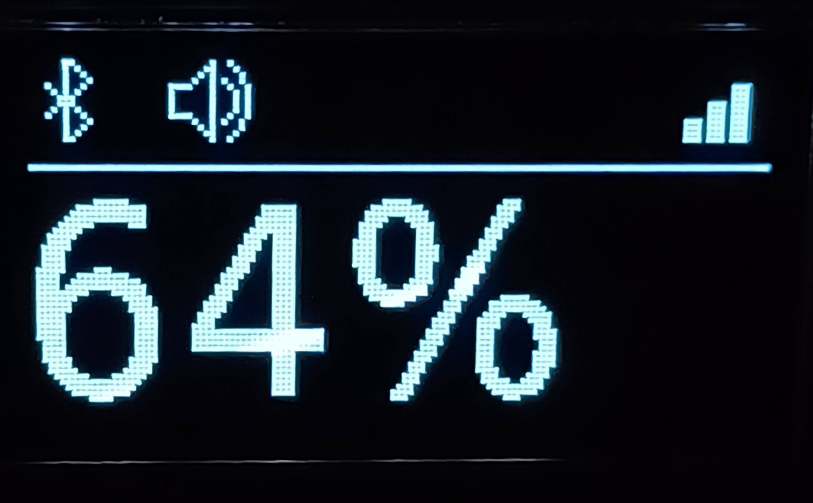

# ESP32 Bluetooth Speaker

A Bluetooth speaker based on ESP32 and ESP-IDF.

The device acts as a Bluetooth Classic A2DP Sink: after power-on it becomes available as a Bluetooth audio device and plays the incoming audio stream through an I2S amplifier.

## Features

- Bluetooth Classic A2DP Sink
- Audio playback through I2S
- SSD1315 OLED display
- Power monitoring through INA219
- Bluetooth connection and playback status display
- Bluetooth RSSI indication
- Battery voltage margin indication
- Custom lightweight I2S driver implemented using ESP32 HAL/LL
- Modular ESP-IDF component-based architecture

The device intentionally provides only the functionality required for receiving and playing an A2DP audio stream. It does not implement additional A2DP source or media-control functionality.

## Hardware

The reference hardware configuration consists of:

| Component | Interface | ESP32 pins | Purpose |
|---|---|---|---|
| ESP32 NodeMCU (38-pin) | — | — | Main microcontroller |
| IP5306 module | — | — | Battery power management and charging |
| SSD1315 display | I2C | SDA: GPIO26<br>SCL: GPIO27 | Display |
| MAX98357 module | I2S | BCLK: GPIO22<br>WS/LRCLK: GPIO23<br>DATA: GPIO21 | Audio output |
| INA219 (CJMCU-219) | I2C | SDA: GPIO26<br>SCL: GPIO27 | Voltage and current monitoring |

The SSD1315 display and INA219 share the same I2C bus.

## User Interface

The reference hardware provides a simple user interface consisting of a power button, charging port, and OLED display.

The display contains:

- playback status;
- Bluetooth connection status;
- Bluetooth RSSI represented by four bars;
- a large battery-related percentage indicator.



### Battery indication

The displayed percentage is **not a battery State of Charge (SoC) estimate**.

Instead, it represents a voltage-based **margin to the operating limits of the IP5306**.

This approach was chosen deliberately because the IP5306 makes its power-management decisions based primarily on battery voltage. Therefore, for this particular device, battery voltage provides a more useful indication of how close the system is to the conditions where the power-management module will stop operation or charging.

## Software

The project is built with:

- ESP-IDF v6.1
- C
- Bluetooth Classic / A2DP
- I2C
- I2S
- ESP32 HAL/LL

The project uses the ESP-IDF I2C driver and Bluetooth Classic stack.

The SSD1315 display driver, INA219 driver, and I2S driver are implemented specifically for this project.

The SSD1315 and INA219 drivers use the ESP-IDF I2C driver, while the I2S driver is implemented using the ESP32 HAL/LL interfaces.

### Component overview

- `app_bt` — Bluetooth initialization and A2DP Sink setup; routes incoming audio stream to the ring buffer.
- `app_i2c` — shared I2C bus initialization.
- `app_i2s_driver` — custom I2S hardware driver; pulls audio data from the ring buffer for playback.
- `app_logger` — application logging handled within a dedicated FreeRTOS task.
- `battery` — battery voltage processing and battery status.
- `display` — SSD1315 display handling and graphical output.
- `power_monitor` — INA219 interface and power measurements.
- `ring_buf` — ring buffer and buffer monitoring functionality.

## Building

### Requirements

- ESP-IDF v6.1
- ESP32 development board
- ESP-IDF toolchain

Clone the repository and configure the project using the standard ESP-IDF workflow:

```bash
idf.py set-target esp32
idf.py build
```

Flash the firmware with:

```bash
idf.py flash
```

Monitor the device with:

```bash
idf.py monitor
```

## License

The original source code and original graphical assets in this project are licensed under the MIT License.

This project also contains bitmap glyph data derived from DejaVu Fonts. Those glyphs are distributed under the DejaVu Fonts License.

See:

- [`LICENSE`](LICENSE) — license for original project code and assets.
- [`THIRD_PARTY_LICENSES/DejaVu_Fonts_License.txt`](THIRD_PARTY_LICENSES/DejaVu_Fonts_License.txt) — full DejaVu Fonts License.

ESP-IDF and its components are external dependencies and are not included in this repository. Their respective licenses apply to those dependencies.

## Author

Created by `TITLE`.